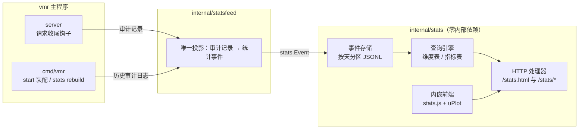

<!-- // Ver 2026-10-20 14:05, by Claude Sonnet 5.5 -->

# Virtual Model Router (vmr) — 设计方案 · 请求统计（明细存储 + 查询引擎 + 统计页）

**这是 v4 版设计文档里路由半区的一个子系统专篇。** 它描述控制台背后的请求统计：每请求一个事件、按天分文件的明细存储，进程内的查询引擎，以及 `/stats.html` 与 `/stats/*` 接口。进行中请求（In-flight 注册表、`/status/live`、Live Requests 表）不属于统计，见 LiveStats 设计文档。

配套文档：
- Part 1（Core）—— 审计记录格式与请求收尾钩子是本模块唯一的数据来源。
- LiveStats 设计文档 —— 进行中请求的运行时状态与 Overview 的实时部分。
- Quota 设计文档 —— Token 四分量盖章（`Attempt.tokens`）与本模块的用量数字同源。
- KNOWN_ISSUES —— 与本模块相关的刻意取舍。

---

## 1. 定位与原则

1. **记事实，不记答案。** 存储层只保存每请求一行的宽事件，任何聚合都在查询时计算。能问什么问题不在写入时决定，任意时间范围、粒度、分组与过滤组合都可以事后再问。
2. **模块独立，接口窄。** 统计模块与 vmr 一起发布，但只通过一个值类型（事件）接收数据、只通过 HTTP 接口对外提供数据，不依赖路由、配置、定价等任何内部包。
3. **成功与失败分开度量。** 响应时长、TTFT、吞吐只回答「成功的请求有多快」；失败只回答「有多少、为什么、在哪里」。两者通过维度交叉分析，绝不混算。
4. **公式只有一处。** 每个指标的公式与样本口径只在 Go 的指标登记表里定义一次，前端只负责渲染。
5. **对人可读。** 明细是 JSONL，`jq` / `grep` / `zstd -dc` 即可排查，外部工具（DuckDB CLI 等）可以直接读。

## 2. 模块边界



统计模块与 vmr 其余部分的全部接触点：

| 接触点 | 形式 |
| --- | --- |
| 事件写入 | 值类型 `stats.Event`，经 `Store.Record` 写入；统计模块不知道审计记录的存在 |
| 投影 | `statsfeed.FromRecord` 是审计记录到事件的唯一投影，线上收尾钩子与 `vmr stats rebuild` 共用；`statsfeed.FromJSON` 是重建用的快速解码，最终仍交给它 |
| 生命周期 | `cmd/vmr` 调用 `stats.Open` 打开 `<log_dir>/stats`，退出时关闭；没有配置项 |
| HTTP | `stats.NewHandler` 的处理器由 `server` 挂载，数据路由套上与其他管理接口相同的鉴权 |
| 控制台外壳 | `stats.PageHTML` 携带控制台注入标记，`server` 启动时注入共享 CSS / JS（导航栏、鉴权弹窗），统计页与其他页面外观一致 |
| 其他页面 | Overview 与 Models 页只经 HTTP 接口取数，复用统计模块提供的前端组件 `stats.js`；Overview 的仪表盘另用 `dashboard.js` 与 `dashboard.css` |

`archtest` 的 `allowedDepPackages` 对 `internal/stats` 保持空白名单；`internal/statsfeed` 的白名单是 `{audit, core, jsonscan, stats}`——它只能看见自己要转换的两种形状。

| 文件 | 内容 |
| --- | --- |
| `internal/stats/event.go` | 事件结构与 JSONL 编解码 |
| `internal/stats/row.go` | 内存紧凑行与字符串字典 |
| `internal/stats/store.go` | 日分区、日切与压缩、锁与降级、启动恢复、已关闭分区缓存 |
| `internal/stats/rebuild.go` | 已关闭日文件的原子写入 |
| `internal/stats/registry.go` | 维度登记表、指标登记表、样本面 |
| `internal/stats/query.go` | 查询参数解析、规范化、上限与粒度联动 |
| `internal/stats/engine.go` | 聚合执行、Top-N、环比、事件列表 |
| `internal/stats/http.go` | HTTP 处理器与静态资源 |
| `web/dashboard.js`、`web/dashboard.css` | Overview 的统计仪表盘：控制条、各面板的查询与 SVG 渲染（与 `stats.js`、`stats.html` 同在本包的 `web/` 目录） |
| `internal/stats/web/` | `stats.html`、`stats.js`、vendor 的 uPlot（附 LICENSE） |
| `internal/statsfeed/feed.go` | 投影与重建用快速解码 |
| `internal/statsfeed/prune.go` | 剔除审计行中的正文类字段 |

## 3. 数据模型

### 3.1 事件

每个**通过了协议预检**的请求在收尾时产生一个事件。两条准入规则由投影统一执行：

- 预检前就被拒的请求（401、请求体不可读、没有模型名）不记账——没有虚拟模型可以归属，扫端口的 401 也不该进统计；
- `vmr replay` 写出的记录（`replay_of` 非空）不记账——重放直连上游，从不经过线上收尾钩子，重建时也必须排除，两条路径才一致。

另有两条记账规则，同样在投影里统一执行：

- `outcome` 为 `canceled`、但转发 attempt 没有错误类别（`audit.Record.DeliveredInFull`）的记录按 `ok` 记账。这是服务端修正判定之前写出的审计记录——客户端收完最后一个字节就断开，旧判定把它记成取消；新记录不会再出现这种组合，所以这条规则对线上路径是空操作，只在重建历史时生效。
- 记录的 `outcome` 为 `ok`、但终态 attempt 带错误类别的记录按 `error` 记账。审计的 `outcome` 只看状态码：流式响应在 200 已经发出之后被上游截断（类别 `truncated`），记录里仍是 `ok`；对客户端这是一次失败的请求，记成 `ok` 会让它躲开 Reliability 的失败视图，还把它的耗时混进成功请求的分位数。它的 token 照常计入（已经花掉了）。`error_class` 因此保持「成功时为空」。

```json
{"ts":"2026-10-19T14:03:11.482+08:00","vmodel":"coding","protocol":"anthropic-messages","stream":true,
 "client_key_tag":"alice","outcome":"ok","status":200,"attempts":1,
 "provider":"volc_coding_plan","model":"glm-5.3","key_label":"fd545d","forwarded":true,
 "dur_ms":16177,"ttft_ms":820,"tokens":{"in":26,"out":528,"cache_read":10240,"cache_write":0},
 "has_tools":true}
```

| 字段 | 含义 | 省略规则 |
| --- | --- | --- |
| `ts` | 请求到达时刻，RFC3339 毫秒精度，带写入时偏移；决定分桶 | 必有 |
| `vmodel` / `protocol` / `stream` | 客户端请求的模型名（直连寻址时为 `provider:model`）、入口协议、是否流式 | 必有 |
| `client_key_tag` | 调用方标识 | 未鉴权时省略 |
| `outcome` | `ok` / `error` / `canceled` | 必有 |
| `status` | 终态 HTTP 状态码 | 无 HTTP 交换时省略 |
| `error_class` | 原样引用路由半区的盖章；零尝试失败合成 `no_candidate` | 成功时省略 |
| `attempts` | 上游尝试次数 | 必有（零尝试为 0） |
| `provider` / `model` / `key_label` | 端点归因：转发成功取生效尝试，完全失败取终态尝试 | 零尝试时省略 |
| `forwarded` | 是否有尝试真正转发成功——用量面的权威门 | 必有 |
| `dur_ms` / `ttft_ms` | 客户端视角总耗时 / 首字延迟；`ttft_ms` 为 0 表示未测量 | 必有 |
| `tokens` | 四分量原始计数，`in` 为净输入（fresh），来自 `Attempt.tokens` 盖章 | 未转发、没有盖章或四项全零时省略（见下） |
| `has_tools` / `has_image` | 请求是否带工具定义 / 图片（来自审计记录的 `facts`） | 为 false 时省略 |
| `src` | `vmr stats rebuild` 写出的事件为 `"audit"` | 线上写入时省略 |

字段名与审计日志、`vmr analyze` 保持一致（`client_key_tag`、`key_label`、四分量），一套 `jq` 习惯同时适用于两种文件。字段契约只增不减：旧事件缺字段即「未知」，不进依赖该字段的指标样本池。

**token 的「未知」不是 0。** 转发了、但没有 token 记录（审计记录早于盖章，或盖章四项全零）的事件，在内存行里带「无 token」标志，写文件时也不带 `tokens`：token 类指标不累加它，查询结果的 `meta.tokens_unknown`（环比窗口为 `compare.tokens_unknown`）报告被跳过的条数，界面据此标注「下限」并隐藏会误导的 token 环比。判定只在一处（`internal/stats` 的行转换）：转发了、四项全零，一律视为未知——真实响应至少有输入 token，全零等价于没测到。

### 3.2 目录与文件

```
<log_dir>/stats/
  .lock                     进程锁
  2026-10-19.jsonl          今天：追加写
  2026-10-18.jsonl.zst      已关闭的天：zstd 压缩，不可变
```

- **独立子目录**：审计的 housekeeping 会清理 `log_dir` 根目录的过期临时文件，独立子目录让两个模块的文件管理互不相干。目录 0700，文件 0600，与审计日志同一标准。
- **锁**：未获锁的实例（`-audit=false` 下两个进程指向同一目录时才可能发生）降级为纯内存：只统计今天，不读不写文件，启动时打一行 WARN。
- **写入**：每个事件一次 `Write` 一整行，不做用户态缓冲——崩溃最多丢一行，读取时跳过撕裂行。写失败则关闭文件、当天剩余时间降级为纯内存，不逐请求重试。
- **日切**：本地午夜后的第一个事件惰性触发，不设常驻定时器：关闭昨天的文件、打开今天的文件，后台把昨天压缩为 `.jsonl.zst`（临时文件 + 原子 rename，再删除原文件）。两者同时存在时以 `.zst` 为准。启动时顺带压缩崩溃遗留的未压缩历史文件。
- **迟到事件**：跨午夜的长请求写进完成时打开的那个文件，按自己的 `ts` 分桶；查询读取 `[day(from), day(to) + 1]` 的全部文件再按 `ts` 过滤（前提是单请求不超过 24 小时，服务端超时远小于此）。重建遵守同一条归档规则：事件归入 `ts + dur_ms` 所在的本地日（`stats.DayOf`），否则线上与重建对同一个跨午夜请求会选不同的文件，相邻两天一边线上写、一边重建时就会重复计数或丢失。
- **保留**：永久保留，不删除。审计日志默认保留 90 天，统计事件因此是唯一的长期记录。体量参考：每行约 300 B、压缩约 10 倍以上——本机 76,200 个事件压缩后 1.7 MB。
- **启动恢复**：取锁 → 载入今天的文件 → 后台压缩遗留文件 → 打开今天的文件追加。启动成本是 O(今天)。

### 3.3 与审计日志的关系

事件是审计记录的纯投影，两者解耦的理由：审计可以关闭（`-audit=false`），审计带正文、体量大，不适合交互查询，也会按保留期清理。审计关闭时收尾钩子仍然在内存里拿到完整的审计记录，统计照常工作。

## 4. 分析框架

控制台上的每一项统计都是同一种形状：选时间窗 →（可选）选分组维度 → 算一组指标 → 画成表或时序图。引擎因此只支持这一种查询形状。

### 4.1 分析主题

| 主题 | 回答的问题 | 主要指标 | 常用分组 | 常用交叉 |
| --- | --- | --- | --- | --- |
| 流量 Traffic | 请求量怎么变化、错误集中在什么时候 | `req` `ok` `err` `canceled` `err_rate` `failover_rate` | 无 / `vmodel` / `endpoint` | `client`、`protocol` |
| 用量 Tokens | token 花在哪里、缓存命中如何 | `tok_fresh` `tok_cache_write` `tok_cache_read` `tok_out` `tok_prompt` `tok_total` `cache_hit` `share_tok` | `endpoint` / `client` / `key_label` / `vmodel` | `has_tools`、`has_image` |
| 性能 Performance | 成功的请求有多快 | `ttft_p50/p90/p99` `toks_p50/p10/avg` `dur_p50/p90/avg` | `endpoint` / `model` / `provider` | `hour_of_day`、`client`、`has_image`、`stream` |
| 可靠性 Reliability | 失败有多少、为什么、在哪里 | `req` `err_rate` `cancel_rate` `failover_rate` `share_req` | `error_class` / `status` / `endpoint` / `attempts` | `vmodel`、`hour_of_day` |
| 分摊 Attribution | 谁用了多少 | `req` `tok_total` `share_req` `share_tok` | `client` / `key_label` / `vmodel` | `endpoint` |
| 明细 Events | 这个数字背后是哪些请求 | 逐条事件 | — | 任意过滤 |

主题只决定界面上的默认值；任意「维度 × 指标」组合在引擎层都合法。

### 4.2 维度

| 维度 | 来源 | 取值说明 |
| --- | --- | --- |
| `vmodel` | 事件字段 | 直连寻址时为 `provider:model` |
| `protocol` | 事件字段 | 入口协议 |
| `endpoint` | 派生：`provider:model` | 未发出任何尝试的事件为空，界面显示为 `(unrouted)` |
| `provider` / `model` / `key_label` | 事件字段 | 同上，可能为空 |
| `client` | `client_key_tag` | 未鉴权时为空 |
| `stream` / `forwarded` / `has_tools` / `has_image` | 布尔 | `true` / `false` |
| `outcome` | 事件字段 | `ok` / `error` / `canceled` |
| `error_class` | 原样引用路由半区的盖章 | 成功时为空；统计侧永不二次分类 |
| `status` | HTTP 状态码 | 无 HTTP 交换时为空 |
| `attempts` | 分档 | `0` / `1` / `2` / `3+` |
| `hour_of_day` / `weekday` | 由 `ts` 按 `time.Local` 派生 | `00`–`23` / `Mon`–`Sun`；只能分组与过滤，不能当粒度 |

### 4.3 指标与样本面

| 样本面 | 包含哪些事件 | 回答什么问题 |
| --- | --- | --- |
| 请求面 | 全部记账事件 | 来了多少、失败多少、为什么失败、在哪里失败 |
| 用量面 | `forwarded` 的事件（含转发后被取消的） | 实际消耗了多少 token——已转发的请求不论结局都产生了真实消耗，与 quota 计量口径一致 |
| 质量面 | `outcome = ok` 且 `forwarded` | 成功的请求有多快——失败与取消的耗时没有意义，混进来只会污染分位数 |

| 指标 | 公式 | 样本面 |
| --- | --- | --- |
| `req` / `ok` / `err` / `canceled` | 事件数、按 `outcome` 计数 | 请求面 |
| `err_rate` / `cancel_rate` | `err / req`、`canceled / req` | 请求面 |
| `failover_rate` | `attempts > 1` 的事件数 / `req` | 请求面 |
| `share_req` | 本组 `req` / 同一时间桶内所有组的 `req` | 请求面 |
| `tok_fresh` / `tok_cache_read` / `tok_cache_write` / `tok_out` | Σ 对应分量（`tok_fresh` 即 `tokens.in`） | 用量面 |
| `tok_prompt` | Σ(`in` + `cache_read` + `cache_write`) | 用量面 |
| `tok_total` | `tok_prompt` + `tok_out` | 用量面 |
| `cache_hit` | Σ`cache_read` / Σ`tok_prompt` | 用量面 |
| `share_tok` | 本组 `tok_total` / 同一时间桶内所有组的 `tok_total` | 用量面 |
| `dur_avg` / `dur_p50` / `dur_p90` / `dur_p99` | `dur_ms` | 质量面 |
| `ttft_avg` / `ttft_p50` / `ttft_p90` / `ttft_p99` | `ttft_ms` | 质量面，且 `stream`、`ttft_ms > 0` |
| `toks_p50` / `toks_p10` | 逐事件生成速率 `out / (dur − ttft)` | 质量面，且 `stream`、`ttft_ms > 0`、`out > 0`、生成区间 ≥ 50 ms |
| `toks_avg` | Σ`out` / Σ生成区间（和之比，不是逐事件速率的均值） | 同 `toks_p*` |

- **TTFT 与吞吐只对流式请求有定义。** 非流式（JSON）请求一次性返回整个响应，没有「首字」的概念；它的快慢由 `dur_*` 表达。
- **生成区间下限 50 ms**：上游把尾部几个块背靠背刷出时，几个 token 除以几毫秒会得到物理上不可能的速率，单个样本就能主导分位数。
- **分位数**：nearest-rank（`ceil(p·n)`，夹到 `[1, n]`），对过滤后的子集精确计算。TTFT 看 p90（成本型，劣质尾在高位），吞吐看 p10（产出型，劣质尾在低位）。无样本的格子输出 `null`，界面显示 `—`。

### 4.4 参数范围

| 参数 | 取值范围 | 界面默认与快捷档 |
| --- | --- | --- |
| 时间范围 | 任意 `[from, to)`，单次跨度 ≤ 90 天；能查到的历史不设上限 | 默认 7 天；快捷档 1h / 6h / 12h / 24h / 3d / 7d / 30d；自定义起止（按天） |
| 按条数取窗 | `last` ≤ 1000，与时间范围互斥 | 10 / 30 / 100 / 300 |
| 粒度 | `none`、`auto`、`1m` / `5m` / `15m` / `1h` / `6h` / `1d` | `auto` |
| 分组 | 接口 ≤ 3 维；界面 ≤ 2 维 | 由视图决定 |
| Top-N | 有分组时按 `req` 取前 N 组（1–1000，缺省 20），其余合并为 `(other)` | 表格 50；图表 8 |
| 过滤 | 任意维度的「取值集合内 / 外」，可叠加 | 由下钻或「+ filter」添加 |
| 环比 | `prev`：向前平移范围自身的长度；`day` / `week`：平移整 1 / 7 个日历日 | 关闭；Overview 在 today 用 `day`，其余范围用 `prev` |

- **粒度联动**：显式粒度产生的桶数超过 500 时自动放粗到阶梯上满足条件的最细一档；`auto` 取桶数 ≤ 200 的最细一档（1h → 1m，6h → 5m，24h → 15m，7d → 1h，30d → 6h，90d → 1d）。实际粒度在响应中回显。
- **桶对齐**：有粒度时 `from` 按 `time.Local` 墙钟向下对齐到粒度边界（`1d` 对齐到本地午夜），所以 `from=-6d&step=1d` 恰好是包括今天在内的 7 个日历日。桶序列按「绝对时长累加、整日按日历日累加」生成，没有夏令时的部署（Asia/Shanghai 等）不受影响；有夏令时的时区里，亚日粒度的桶在时钟回拨之后会沿用回拨前的分钟偏移直到范围结束，环比的绝对平移在夏令时前后也会差一小时。这是已知的边界，没有为此引入按日重新对齐。

## 5. 查询引擎

### 5.1 内存结构

- **行**：定长结构体。字符串维度替换为全局字典的 `uint32` 编号，`status` 为 `uint16`，`attempts` / `outcome` / 布尔标志为 `uint8`，`dur_ms` / `ttft_ms` 为 `int32`，`ts` 为毫秒 `int64`，四分量为 `int64`。约 80 B / 行。
- **字典**：全局、只追加，编号永不复用。
- **今天的分区**：写入在锁内追加；查询在锁内只取切片头，扫描在锁外进行。已追加的元素永不修改，扩容后旧底层数组对已取到的长度仍然有效，所以写入不会被查询阻塞。
- **已关闭分区**：按需从文件载入，载入串行化在一把独立的载入锁里；载入后不可变。每次查询对所需分区做一次 `stat`，文件大小或修改时间变化即重新载入——在线重建因此无需通知运行中的进程。缓存上限按分区个数计（120 个，覆盖任意 90 天查询并留余量），超出按最近最少使用淘汰。
- **不做查询结果缓存**：7 天查询是毫秒级，90 天带分位数约百毫秒，控制台的统计取数是分钟级刷新；结果缓存只会带来失效逻辑。

### 5.2 执行

确定分区集合 → 逐行按 `ts` 与过滤条件筛选 → 计算桶号与组键 → 累加加性量、按需收集分位数样本 → 按全窗口 `req` 排出 Top-N，其余并入 `(other)` → 收尾计算比率、分位、占比 → 输出。

- 只请求计数类指标的查询不分配任何样本切片；分位数样本池按指标需要收集。
- 有粒度时输出**稠密**结果：每个桶 × 每个保留的组一行，空格子的计数为 0、比率与分位为 `null`，前端直接画图，不需要补零。
- `last=N`：从今天往前逐个分区、分区内从后往前取满 N 个匹配事件（即最近完成的 N 个），再在这个集合上聚合，不分桶。
- 环比：同一查询在向前平移的范围上再执行一次，平移方式由 `compare` 决定（见参数表）。`day` / `week` 平移整日历日，是给「周期本身就是一个日历日」的范围用的：「今天到现在」的上一个周期是昨天到同一时刻，而不是今天零点之前的那一段。
- **行的筛选下界用原始 `from`，对齐只决定桶原点。** 有粒度时 `from` 向下对齐到桶边界，第一个桶因此可能早于范围开始；若用对齐后的起点筛选，分桶查询会比不分桶查询多算最多一个桶的流量（24h 范围、15 分钟一桶时约 7%），头部数字与柱子之和对不上。引擎把两者分开（`Query.Floor` 筛选、`Query.From` 切桶），分桶与不分桶的合计在任何范围都相等，由差分测试锁定；环比窗口的三个时刻用同一个平移量，所以图上的虚线与头部的环比说的是同一个窗口。

## 6. HTTP 接口

### 6.1 路由

| 路由 | 鉴权 | 说明 |
| --- | --- | --- |
| `GET /stats.html` | 免（外壳不含数据） | 统计页 |
| `GET /stats/schema` | 是 | 维度表、指标表（含说明文字、类别、样本面）、粒度阶梯、上限 |
| `GET /stats/query` | 是 | 聚合查询 |
| `GET /stats/events` | 是 | 逐条事件（下钻、最近失败） |
| `GET /stats/assets/*` | 免（静态资源） | `stats.js` 按内容 ETag 校验；uPlot 带版本号文件名，长期缓存 |
| `GET /stats` | — | 302 到 `/stats.html` |

统计存储打不开时（`log_dir` 不可用），`/stats/query` 与 `/stats/events` 返回 503，页面与 `/stats/schema` 照常。`/stats/*` 整个命名空间归统计模块，进行中请求的 `/status/live` 归运行时状态。

### 6.2 `GET /stats/query`

| 参数 | 说明 |
| --- | --- |
| `from` / `to` | 绝对时间（`2026-10-01`、RFC3339）或相对时间（`-30m`、`-24h`、`-7d`、`today`、`now`）。缺省 `-7d` 到 `now`；处理器把 `now` 取为当前毫秒的末尾，行的时间戳是毫秒精度、范围是半开区间，否则恰好在查询同一毫秒完成的请求会落在被排除的右端点上 |
| `last` | 按条数取最近 N 个匹配事件，与 `from` / `to` / `step` / `compare` 互斥 |
| `step` | `none`（缺省）/ `auto` / `1m` / `5m` / `15m` / `1h` / `6h` / `1d` |
| `where`（可重复） | `dim:v1\|v2`（取值集合内）或 `dim!v1\|v2`（取值集合外）；同一维度内为 OR，不同 `where` 之间为 AND；维度名只含小写字母与下划线，其后第一个字符就是操作符，值里可以出现 `:`；值里的字面竖线与反斜杠各自前置一个反斜杠转义（模型名由客户端决定，可以含任何字符） |
| `group` | 逗号分隔，至多 3 个维度 |
| `metrics` | 逗号分隔，取自指标表，缺省 `req` |
| `top` | 1–1000，缺省 20 |
| `compare` | `prev`（平移范围自身的长度）、`day`（整 1 个日历日）、`week`（整 7 个日历日）；附带环比结果，回显里为 `compare_by` |

```
GET /stats/query?from=-30d&step=1d&group=endpoint&where=vmodel:coding|agent&where=outcome!canceled
                &metrics=req,err_rate,tok_prompt,cache_hit,ttft_p90&top=8&compare=prev
```

```json
{
  "query":   {"from":"2026-09-19T00:00:00+08:00","to":"2026-10-19T17:00:00+08:00","step":"1d",
              "group":["endpoint"],"where":[{"dim":"vmodel","in":["coding","agent"]},{"dim":"outcome","not_in":["canceled"]}],
              "metrics":["req","err_rate","tok_prompt","cache_hit","ttft_p90"],"top":8,"compare":true},
  "columns": [{"name":"bucket","kind":"time"},{"name":"endpoint","kind":"dim"},
              {"name":"req","kind":"count"},{"name":"err_rate","kind":"ratio"},{"name":"tok_prompt","kind":"tokens"},
              {"name":"cache_hit","kind":"ratio"},{"name":"ttft_p90","kind":"ms"}],
  "rows":    [["2026-09-19T00:00:00+08:00","volc_coding_plan:glm-5.3",412,0.012,18400000,0.83,1840]],
  "totals":  [null,null,9120,0.009,402000000,0.81,1710],
  "compare": {"from":"2026-08-20T00:00:00+08:00","to":"2026-09-19T00:00:00+08:00","rows":[],"totals":[]},
  "meta":    {"rows_scanned":91200,"partitions":31,"groups_truncated":3,"tokens_unknown":0}
}
```

- `rows` 用二维数组，列名只出现一次；`totals` 是整个窗口不分桶、不分组的同一组指标。
- 时间都是服务器本地时区的 RFC3339 字符串，前端按字符串显示，不在浏览器里换时区。
- 未知维度或指标、跨度超限、时间无法解析 → 400，响应体 `{"error": "..."}` 写明原因。

### 6.3 `GET /stats/events`

参数为 `from` / `to` / `where` 与 `limit`（缺省 100，上限 1000），按到达时间倒序返回 `{"events": [...]}`，字段与文件中的事件一致。给了 `from` 时只读取范围覆盖的那几天的分区（与聚合查询同一套选择，所以任何历史范围的下钻都能看到聚合里数出来的那些事件，短范围也不会载入整个历史）；没有 `from` 时从今天往回扫，用于「最近 N 条」。

## 7. 页面

### 7.1 设计原则

- **页面是框架的投影**：每个统计区块都是「一条查询 + 一个渲染器（表或时序图）」。新增视图就是新增一组查询参数，不新增渲染代码。
- **一个组件，三个页面复用**：`stats.js` 只做三件事——调接口、画 uPlot 图、渲染表格（表尾、排序、下钻）。页面脚本只决定「这一块用什么参数」。Overview 的仪表盘是例外：它的堆叠柱、faults 轨和小倍数图由 `dashboard.js` 手写 SVG（见决策表「仪表盘图表」）。
- **格式化只有一处**：数字按指标类别（计数 / token / 比率 / 毫秒 / 速率）格式化，类别来自 `/stats/schema`。
- **沿用控制台风格**：用 `console.css` 的设计令牌与组件；图表颜色取自同一组令牌。未分组的图按指标含义着色（错误红色、四个 token 分量与控制台一贯配色一致），分组的图按组着色；计数与 token 坐标轴按 1-2-5 整数步进。

### 7.2 Overview（`/status.html`）：现在怎么样，以及最近一段时间怎么样

上半部分是「此刻」：指标带（In flight、端点健康、逐请求一行的 Live 摘要、资源行）与按需展开的 Live Requests 表，见 LiveStats 设计文档。下半部分是统计仪表盘，由 `dashboard.js` 渲染：一个控制条决定全部面板的时间范围（1h · 6h · 12h · today · 1d（默认）· 3d · 7d · 30d）、过滤条件（调用方、端点、虚拟模型三个维度，在 Breakdown 表里点名称加入，标签上可在 = 与 ≠ 之间切换）与是否对比；状态写进 URL hash。对比的语义对所有范围统一：对比「同一范围向前一个周期」——范围的周期就是它自己的长度（1h 对上一个小时、7d 对上一个 7 天），所以 1h 到 30d 都是 `compare=prev`；只有 today 的周期是一个日历日，它对比昨天到同一时刻（`compare=day`），而不是今天零点之前的那一段。开关的文字随之变化（today 为「vs same time yesterday」，其余为「vs previous period」）。

**统计与「此刻」是两个故障域。** `dash.refresh()` 自己消化失败（统计存储不可用、某条查询返回 4xx / 5xx）：在头部卡片位置显示「Statistics unavailable」、原因与重试按钮，其余面板收起，控制条保留；并发、端点健康、告警、系统行与 Live Requests 照常渲染。页面不会因为统计出问题而整页暂停。仪表盘只用 `/stats/*`，自由组合的查询仍在统计页。

| 面板 | 数据源 | 说明 |
| --- | --- | --- |
| 头部 4 张卡：Requests、Tokens、Latency（TTFT p50，另列 p90、耗时 p50、Tok/s p50）、Reliability；每张卡底部一条趋势线（Reliability 为每桶的错误加取消数，范围内没有失败时也画出基线） | 一条不分桶的查询（带 `compare`）给数值与环比；`attempts:2\|3+` 按 `outcome` 分组给 failover 与救回数；`from=today` 给「今日」 | 环比颜色：请求与 token 是量，用中性色；延迟、错误、缓存命中分好坏色；相对 ±5%、比例 ±0.3pp 以内显示「≈」。`meta.tokens_unknown` 非零时，Tokens 卡片列出「no token record」条数，并在窗口或其环比窗口里有未知时不显示 token 环比（显示 n/a） |
| Activity | `step=auto`：按状态（outcome）分组的请求数；四个 token 分量（带 `compare`，虚线是对比窗口的总量，图例写明是哪个窗口；拆分或隐藏了序列时不画虚线、图例也不出现）；按调用方 / 端点拆分时按需查 `group=<dim>&top=6`；拆分顺序为 caller / endpoint / status（token 视图的第三项是 token type），默认 caller | 堆叠柱。请求视图的任何拆分下图下都有 faults 轨（取消黄点、错误红点），低错误率也看得见；Tokens 视图默认隐藏 cache read 并重新缩放；点柱子列出该桶的请求（第一个桶从范围起点开始列，与图上的数字一致） |
| Composition | 不分桶：token 四个分量；`group=stream` / `has_tools` / `has_image` 的请求占比与 token 占比 | 流式请求占比与 token 占比相差悬殊时给出结论；有无 token 记录的请求时注明这些数字是下限 |
| Breakdown | `group=<dim>&top=50`（带 `compare=prev`），标签页：调用方（默认）/ 端点 / 虚拟模型（上游 key 只在统计页分组与过滤） | 成对列（`p50 / p90` 等）；「token detail」列组展开四个分量；点名称加入过滤；行尾列出该行的请求 |
| Speed | 比计数粗一档的粒度（1d → 1h，7d → 6h）上的 Tok/s、TTFT、耗时分位，按这个顺序排列 | 粗一档是为了单个慢请求不把曲线拉成尖峰。大数字一律是中位数 p50；尾部是虚线：TTFT 与耗时看 p90（90% 的请求不超过它，最慢的 10% 在它之上），Tok/s 方向相反，慢是低，所以看 p10（90% 的请求至少达到这个速率） |
| Reliability | `where=outcome!ok&group=error_class`；`/stats/events?where=outcome!ok&limit=100`；`/stats/events?where=outcome:canceled&limit=1000` | 取消耗时分布在前端由取消事件算出；距某个 30 秒整数倍（60 s、90 s …）不到 1 秒的取消聚集三次以上，判为调用方超时（调用方先于 vmr 开始计时，所以记录值可能略小于超时值，窗口是双侧的）；失败类别可点选过滤下面的失败明细，空类别显示为 (none) 且同样可选 |
| Usage pattern | `group=weekday,hour_of_day&top=168` | 只在 7d / 30d 显示，更短的范围只能填满一两行。格子是「每小时平均请求数」：计数除以该「星期 × 钟点」在范围内出现的小时数（7d 恰为 1，30d 为 4 或 5），不同范围的读数含义相同 |

整页 5 分钟刷新一次，默认视图约 13 条查询；切换 Activity 拆分与 Breakdown 标签页时才补查对应的一条。

### 7.3 统计页（`/stats.html`）：分析

页面自上而下：
1. **视图**：Traffic、Tokens、Performance、Reliability、Callers、Custom。每个视图只是一组预设参数；切换视图就是改控件值。
2. **范围与粒度**：快捷档、自定义起止，或「最近 N 条」；粒度；「对比上一周期」。
3. **分组、过滤、指标**：两个分组下拉框；过滤条件是可删除的标签，「+ filter」的候选值来自一条 `group=<dim>&metrics=req` 的查询；指标按样本面分组多选。所有选项来自 `/stats/schema`。
4. **图表**：uPlot 折线图，一个图表指标；每个组一条线，至多 8 条；分位与比率在空桶处断开，所以总是画出数据点。「最近 N 条」模式下不画图。
5. **表格与明细**：分组列 + 指标列，表尾合计，可排序；点击维度格子加为过滤条件；行尾「events」列出该行背后的请求；开启环比时表下列出上一周期的合计与变化率。

| 视图 | 预设参数 |
| --- | --- |
| Traffic | 无分组；`req,ok,err,canceled,err_rate,failover_rate`；图 `req`、`err` |
| Tokens | `group=endpoint`；`tok_fresh,tok_cache_write,tok_cache_read,tok_out,tok_total,cache_hit,share_tok`；图 `tok_total` |
| Performance | `group=endpoint`，`where=outcome:ok`（只看成功请求，`req` 即成功请求数）；`req,ttft_p50,ttft_p90,toks_p50,toks_p10,dur_p50,dur_p90`；图 `ttft_p90` |
| Reliability | `group=error_class`，`where=outcome!ok`；`req,share_req`；图 `req` |
| Callers | `group=client`；`req,ok,err,tok_prompt,cache_hit,tok_out,toks_avg,share_tok`；图 `tok_total` |

全部状态编码在 URL hash 里，收藏链接就是保存视图，刷新页面状态不丢。

### 7.4 Models（`/models.html`）

Quota 表的 24h 请求数来自 `group=provider,model`，拓扑表的 24h 请求数与在虚拟模型内的占比来自 `group=protocol,vmodel,endpoint`，均为 `from=-24h&metrics=req&top=1000`。

### 7.5 前端实现

- **uPlot 1.6.32**（MIT，压缩后 51 KB JS + 1.9 KB CSS）原样 vendor 在 `internal/stats/web/vendor/`，附 LICENSE；经 `/stats/assets/` 以带版本号的文件名提供，不走 CDN。它发布节奏很慢，固定版本几乎没有维护成本。
- **不内联**：控制台的共享 CSS / JS 仍在启动时内联进每个页面；uPlot 只有统计相关页面需要且体积较大，所以作为独立静态资源长期缓存。
- **时区**：图表横轴通过 uPlot 的 `tzDate` 显示服务器墙钟，而不是浏览器所在时区。
- **安全**：外壳免鉴权、数据请求带 `VMRAuth` 凭据；文本经 `esc()` 转义，属性值另经 `VMRStats.attr` 转义引号（维度值与 JSON 会进入属性）。
- **测试**：Node 渲染测试执行三个页面的脚本与 `stats.js`，请求的是真实的统计后端（填充过的存储 + 真实处理器）；画图一步由桩记录调用。

## 8. 实时更新

统计数据的刷新是分钟级：跟随整页 5 分钟刷新与用户操作，不需要任何推送机制。进行中请求的实时部分保留自适应短轮询（`/status/live`），理由见 LiveStats 设计文档；其中决定性的一点是浏览器的 `EventSource` 与 WebSocket 都不能携带 `Authorization` 请求头。

## 9. 历史重建与生产操作

### 9.1 `vmr stats rebuild`

```
vmr stats rebuild [-c config.yaml] [-dir DIR] [-from YYYY-MM-DD] [-to YYYY-MM-DD] [-force] [-dry-run] [audit.jsonl|glob]...
```

- **输入**：缺省读取 `<log_dir>/vmr-audit-*`（与 `vmr analyze` 相同的定位规则，`.zst` 透明解压）；也可以显式传文件或通配符。
- **口径**：逐行经 `statsfeed.FromJSON` 投影（先剔除 `body` / `headers` / `raw_pre_strip`，再只解码需要的字段，最终交给 `statsfeed.FromRecord`），写出的事件带 `src:"audit"`。线上路径与重建路径的一致性由差分测试锁定：同一批记录经真实审计日志落盘后再读回，两条路径产出的事件逐字段相等。
- **范围**：缺省只写已关闭的天（早于今天）。已存在的日文件默认跳过，`-force` 才覆盖；某天得到 0 个事件时不写也不覆盖。每个日文件先写临时文件，再原子 rename 为 `.jsonl.zst`。事件按完成日归档（见迟到事件），没有时间戳的记录只计数、不归入任何一天。`-today` 额外重建今天（写为未压缩的今日文件），要求没有 vmr 持有统计目录的锁，用于部署窗口：先停旧进程、重建今天、再启动新二进制，升级当天不留空洞。
- **在线执行**：缺省不需要停 vmr，不取锁。运行中的进程只写今天的文件，缺省的重建不碰今天；运行中的进程每次查询都会 `stat` 已关闭分区，文件被替换后下一次查询自动重新载入。`-today` 是唯一需要停机的模式。
- **速度**：本机 72 个审计日文件（压缩 1.2 GB，76,200 条记录）全量扫描约 28 秒。
- **精度边界**：审计保留期之外、`-audit=false` 期间的日子无法重建；`Attempt.tokens` 盖章出现之前的记录没有 token 记录（按「未知」处理，不是 0）；`forwarded` 盖章出现之前的记录走 `Attempt.IsForwarded` 的启发式兜底。

### 9.2 生产服务器首次部署

假设部署日为 D（路径与日期按实际替换）：

```bash
# 0. 在开发机上构建目标平台的二进制
GOOS=linux GOARCH=amd64 go build -o vmr ./cmd/vmr

# 1. 部署并重启 vmr 后，确认统计目录开始写入今天的文件
ls -l <log_dir>/stats/

# 2. 预览：每天的审计记录数与将写出的事件数
./vmr stats rebuild -c /path/to/config.yaml -dry-run

# 3. 补齐 D 之前的全部历史（在线执行，不必停 vmr）
./vmr stats rebuild -c /path/to/config.yaml

# 4. D+1 及之后任意时间：用审计日志整天重写部署当天
#    （部署当天的文件只有部署之后的事件；审计日志里有完整的一天）
./vmr stats rebuild -c /path/to/config.yaml -force -from D -to D
#    更干净的做法：部署窗口内先停旧进程，`vmr stats rebuild -today` 重建到今天，再启动新进程

# 5. 抽查：某一天的事件数应等于该天审计中被记账的记录数
zstd -dc <log_dir>/stats/2026-10-01.jsonl.zst | wc -l
zstd -dc <log_dir>/vmr-audit-2026-10-01.jsonl.zst \
  | jq -c 'select(.model != "" and (.replay_of // "") == "")' | wc -l
```

能补到多早取决于服务器上审计日志的保留期（`ttl.audit_retention`，缺省 90 天）。

旧版统计账本留下的 `<log_dir>/vmr-stats-rollup.jsonl`、`vmr-stats-YYYYMMDD-HH.jsonl` 与 `.vmr-stats.lock` 不再读取，也不自动删除：删除不可逆，而它们的内容在审计保留期之外已无法重建。启动时发现它们会打一行提示，由运维决定是否删除。

## 10. 决策与权衡

| 决策项 | 设计选择 | 权衡依据 |
| --- | --- | --- |
| **存储形态** | 每请求一个宽事件，查询时聚合 | 预聚合（按小时 × 维度求和）在写入时就丢掉了明细：时间粒度、可分组维度、分位数都被写死，事后无法补回；本项目规模下明细全量查询是毫秒到百毫秒级 |
| **存储格式** | JSONL，按本地日历日分区，已关闭的天 zstd 压缩 | 人可读、外部工具可直接读；日分区就是时间索引；关闭即不可变，便于压缩与重建 |
| **不用嵌入式数据库** | 按依赖重量、二进制体积、数据透明性、运维复杂度评估后选 JSONL | SQLite（纯 Go 驱动）只替我们省掉分组、排序、百分位约 150–200 行；界面参数白名单、指标口径、本地时区分桶、写入批处理仍要自己写；多 4.5–5.5 MB 二进制与一个外部依赖；modernc 驱动未编入百分位函数；查询慢一到两个数量级 |
| **引擎只支持一种查询形状** | 过滤 → 分桶 → 分组 → 指标 | 控制台需要的就是这一种；临时分析由外部工具直接读文件 |
| **模块边界** | `stats` 零内部依赖；投影单独放在 `statsfeed` | 统计模块只认自己的事件类型；投影是唯一知道审计记录长什么样的地方，线上与重建共用，口径一致由结构保证 |
| **目录** | `<log_dir>/stats/` 独立子目录 | 与审计 housekeeping 互不干扰 |
| **迟到事件** | 写进完成时的日文件，查询多读一天 | 不需要回写累计值的特殊路径 |
| **保留** | 永久 | 审计按保留期清理后，统计是唯一的长期记录；压缩后体量很小 |
| **单次查询跨度** | ≤ 90 天，历史不设限 | 约束单次查询成本，不约束可查范围 |
| **粒度联动** | 桶数 > 500 自动放粗并回显 | 保护浏览器；放粗比报错友好 |
| **分组** | 接口 ≤ 3 维，界面 ≤ 2 维；Top-N + `(other)` | 界面可读性；Models 页的固定查询需要第 3 维 |
| **样本面** | 请求面 / 用量面 / 质量面；质量面只含成功且转发的请求 | 失败与取消的耗时没有意义，混入污染分位数；失败由请求面单独度量 |
| **TTFT 与吞吐** | 只对流式请求有定义 | 非流式请求没有首字的概念 |
| **用量面含转发后取消的请求** | 是 | 已转发就有真实消耗，与 quota 计量一致 |
| **分位数** | 精确计算，nearest-rank | 规模允许，没有近似误差 |
| **指标定义位置** | 只在 Go 的登记表里；经 `/stats/schema` 交给前端 | 前端没有任何公式，不会与后端口径分叉 |
| **查询结果缓存** | 不做 | 成本低、刷新频率低；缓存只带来失效逻辑 |
| **分区缓存** | 按分区个数上限 120，LRU；每次查询 `stat` 失效 | 比按字节估算简单；`stat` 失效让在线重建无需进程间通知 |
| **并发模型** | 只追加切片 + 锁内取切片头、锁外扫描 | 写入不被查询阻塞（`-race` 测试覆盖） |
| **零配置** | 上限都是代码常量 | 都是工程常量，不需要按部署校准 |
| **最近失败** | 由事件派生，持久化 | 失败信息是定量的；重启恰恰是最需要看失败历史的时候 |
| **Overview 与统计页分工** | Overview 是预制仪表盘：固定面板、一个全局范围与过滤；任意组合的查询在统计页 | 常用问题不应每次都手工组合「视图 + 范围 + 分组 + 过滤 + 指标」；面板只留一两个开关，其余由统计页覆盖 |
| **仪表盘图表** | `dashboard.js` 手写 SVG，不用 uPlot | 堆叠柱、隐藏序列后重新堆叠与缩放、faults 轨都要自定义绘制；SVG 是字符串，Node 渲染测试可直接断言；代价是没有框选缩放，范围由控制条切换 |
| **环比区间** | `compare=prev` 带粒度时前后两期都平移「范围内的整桶数 × 粒度」；`day` / `week` 平移整日历日；三个时刻（桶原点、筛选下界、结束）用同一个平移量 | 对齐后的起点不在整桶上；平移后桶 i 正对上一周期同一时刻，两期桶数相同。统一的语义是「向前一个周期」；today 的周期是一天，所以用 `day`。短范围（1h–12h）对比紧挨着的前一段，会受钟点起伏影响，这是接受的：想看同比用统计页的 `compare=day` / `week`。图上的虚线与头部环比必须说同一个窗口 |
| **筛选下界与桶原点分开** | 行按原始 `from` 筛选，对齐后的 `from` 只决定桶从哪里开始 | 分桶与不分桶的合计在任何范围相等，头部数字等于柱子之和；用对齐后的起点筛选会让分桶查询多算最多一个桶 |
| **token 未知 ≠ 0** | 转发了但没有 token 记录（含四项全零）的事件带「无 token」标志，token 指标不累加，`meta.tokens_unknown` 报条数 | 沿用定价模块「nil 是未知，不是免费」的原则；把未知落成 0 会让跨越盖章断点的长范围 token 数与环比无声失真（实测 30d 环比的 token 方向与请求数相反） |
| **截断响应记为错误** | 终态 attempt 带错误类别而记录 `outcome` 为 `ok` 时，事件记 `error` | `outcome` 只看状态码；对客户端这是失败。`vmr analyze` 照记录的 `outcome` 读，不做同样的归正（与取消的归正同理，见 KNOWN_ISSUES） |
| **字典容量上限** | 维度字符串的去重字典最多 65,536 项，之后新值记为 `(overflow)` | 模型名由客户端决定，字典只追加、编号不复用，没有上限就是一个随时间增长的内存口子。未知模型名本身是排障线索（客户端拼错了名字或协议），所以不归一为固定值 |
| **图表库** | vendor uPlot 固定版本 | 体积小、零依赖、发布节奏慢；通用的多序列交互时序图正是手写代码最容易膨胀的地方 |
| **兼容** | 旧 `/stats` JSON 契约直接废除，`GET /stats` 302 到统计页 | 消费方只有同一二进制内的页面（CLI 与 Server 版本必须匹配，不做兼容）；302 只照顾直接输入旧地址的人 |
| **重建** | 同一投影、只写已关闭的天、在线执行、不取锁 | 生产服务器不必停机；`-dry-run` 先核对 |
| **重建解码** | 先字节级剔除正文类字段再解码 | 全量解码审计行要把数 MB 的正文建成 JSON 树再丢弃；剔除后快约 18 倍 |

## 11. 决定不做

| 提议 | 不做的理由 | 重开条件 |
| --- | --- | --- |
| SQLite 作主存储 | 见决策表「不用嵌入式数据库」 | 查询形状不再固定（多表关联、任意表达式）；或需要多进程并发写入 |
| SQLite 作内存查询引擎（JSONL 为源） | 多 5.5 MB 与一个 v0.x 依赖；省下的代码很少；首次载入要付导入成本（90 天约 2.7 s） | 确定要在控制台提供自由 SQL 输入框 |
| 嵌入 DuckDB / chDB | 需要 cgo，破坏从开发机交叉编译服务器二进制的工作流 | 无。作为外部 CLI 是推荐用法：`duckdb -c "select … from read_json('<log_dir>/stats/*.jsonl*')"` |
| 预聚合或分位数草图（t-digest 等） | 前者丢明细；后者引入近似误差，而明细放内存只要几十 MB | 单个分区内存装不下 |
| 直接扫审计日志做统计 | 带正文、体量大、可被关闭、按保留期清理 | — |
| 单次查询超过 90 天 | 更长周期用 `step=1d` 分段查看或外部工具 | 出现稳定的季度对比需求 |
| 保留期 / 内存预算配置项 | 零调参 | 真实部署中出现磁盘或内存压力 |
| 成本（$）指标 | 需要把定价快照注入统计模块；不是红线限制 | 控制台出现明确的成本需求；届时由 `cmd/vmr` 注入一个只读的定价函数，统计模块仍不依赖 `pricing` |
| `vmr stats query` 命令行查询 | 控制台已覆盖；临时分析用外部工具 | 需要在只有 SSH 的环境里频繁看统计 |
| 推送 / SSE / WebSocket | 统计是分钟级刷新；进行中请求的轮询理由见 LiveStats 设计文档 | 同该文档 |

---

## 附录：选型实测快照

- **时间与环境**：2026-10-19，macOS darwin/arm64（Apple M4），Go 1.26.5。
- **数据**：合成 100 万行，相当于 90 天、每天约 1.1 万请求；维度基数高于真实情况。
- **真实流量参考**：本机审计日志 2026-07 至 09 月每天 150–5,364 条请求。

| 操作 | 手写 Go（结构体切片） | modernc.org/sqlite v1.60.1（内存库） | ncruces/go-sqlite3 v0.35.6 + `ext/stats`（内存库） | ncruces `ext/lines` 直接查 JSONL |
| --- | --- | --- | --- | --- |
| 7 天 × 小时 × provider × model，计数 / 求和 / 错误数（16k 组） | 2.7 ms | 88 ms | 81 ms | — |
| 90 天 × 天 × model，求和 | 未单测 | 913 ms | 723 ms | — |
| 90 天 × model，TTFT p50 / p90 | 79 ms | 不支持（未编入百分位函数） | 515 ms | 2,871 ms |
| 7 天 × 小时 × model，TTFT p90 | — | 不支持 | 48 ms | 259 ms |
| 载入 100 万行 | `encoding/json` 解析 2.34 s | 单事务插入 1.64 s | 单事务插入 1.40 s | SQL 导入 2.71 s |
| 二进制增量（strip 后，基线 1.8 MB） | 0 | +4.5 MB | +5.5 MB | +5.5 MB |

实现后的引擎基准（`BenchmarkQuery90d`，100 万行 90 天，按 endpoint 分组带 TTFT p50 / p90 与吞吐 p10）：约 117 ms / 次。真实数据（本机 71,607 个 90 天内事件）的同类查询端到端约 20 ms。

| 规模估算 | 90 天行数 | 内存（约 80 B / 行） |
| --- | --- | --- |
| 每天 2k 请求 | 18 万 | 约 14 MB |
| 每天 5k 请求 | 45 万 | 约 36 MB |
| 每天 2 万请求（团队规模假设上限） | 180 万 | 行数据约 144 MB；实测进程 RSS 约 360 MB（行结构体按 88 B 对齐，再加载入时的解析垃圾与 GC 余量），以 RSS 为准 |

**Go 生态候选调研**（2026-10 查证）：kelindar/column 有过滤与 sum/avg 但没有分组；gota 已归档、dataframe-go 自 2022 年停更、golars 尚无采用；dolthub/go-mysql-server 是完整的 MySQL 引擎且方言没有百分位函数；chaisql 自述尚不适合生产；Apache Arrow Go 偏底层；tstorage / 嵌入 PromQL 的数据模型是「时间序列 + 标签」的指标，分位数需要先做直方图预聚合。真正能做到「不写聚合」的只有 SQLite + 纯 Go 驱动这一类。

参考：
- [SQLite percentile extension](https://sqlite.org/percentile.html)（3.51.0 起进入 amalgamation，默认关闭，需 `SQLITE_ENABLE_PERCENTILE`）
- [modernc.org/tpch 基准（2026-03）](https://pkg.go.dev/modernc.org/tpch)
- [cvilsmeier/go-sqlite-bench](https://github.com/cvilsmeier/go-sqlite-bench)
- [kelindar/column](https://pkg.go.dev/github.com/kelindar/column)
- [go-mysql-server](https://www.dolthub.com/docs/architecture/sql/go-mysql-server)
- [chaisql/chai](https://www.github.com/chaisql/chai)
- [uPlot](https://github.com/leeoniya/uPlot)
